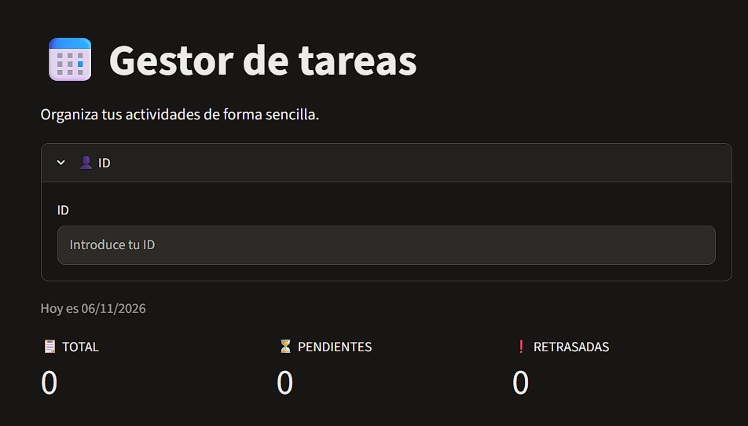
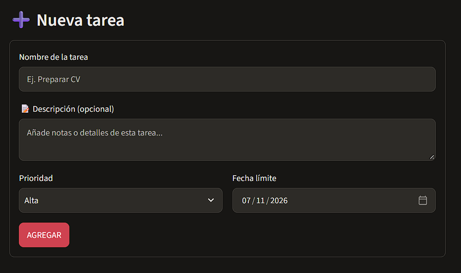
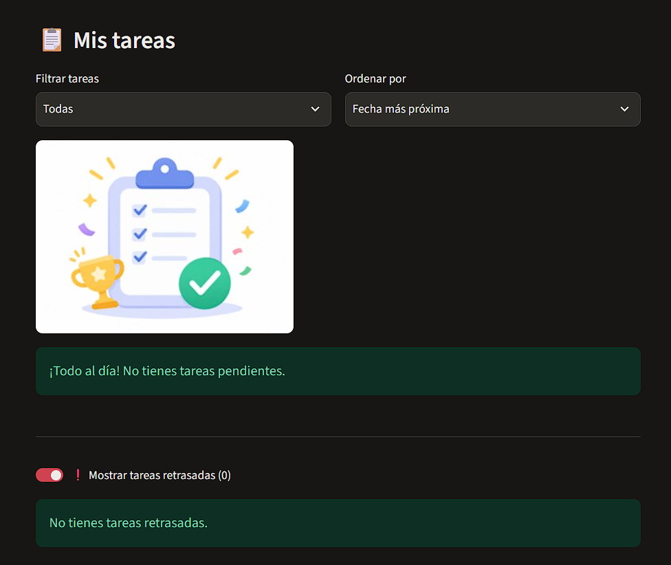

# 📅 Gestor de tareas

Aplicación web desarrollada con Python y Streamlit para organizar y gestionar tareas personales.

## 📸 Capturas de pantalla

### Interfaz principal



### Crear una nueva tarea



### Lista de tareas



## Funcionalidades

- Crear, editar y eliminar tareas.
- Añadir descripciones a las tareas.
- Asignar prioridades: Alta, Media y Baja.
- Establecer fechas límite.
- Filtrar y ordenar tareas.
- Identificar tareas retrasadas.
- Mostrar u ocultar las tareas retrasadas.
- Visualizar estadísticas de progreso.
- Configurar un ID de usuario.
- Guardar los datos localmente mediante JSON.

## Tecnologías utilizadas

- Python
- Streamlit
- JSON
- Git y GitHub


## 🚀 Instalación y ejecución

### 1. Clonar el repositorio

```bash
git clone https://github.com/jing-yl62/gestor_de_tareas.git
cd gestor_de_tareas
```

### 2. Crear un entorno virtual

En Windows:

```bat
python -m venv .venv
```

En macOS o Linux:

```bash
python3 -m venv .venv
```

### 3. Activar el entorno virtual

Windows (CMD):

```bat
.venv\Scripts\activate.bat
```

macOS o Linux:

```bash
source .venv/bin/activate
```

### 4. Instalar las dependencias

```bash
python -m pip install -r requirements.txt
```

### 5. Ejecutar la aplicación

```bash
python -m streamlit run app.py
```

### 6. Abrir la aplicación

Accede desde el navegador a:

http://localhost:8501


## 💾 Almacenamiento

Las tareas y el ID de usuario se guardan localmente
en archivos JSON.

Los archivos `tareas.json` y `usuario.json` se crean
automáticamente cuando se guardan datos por primera vez.

Estos archivos están excluidos del repositorio
mediante `.gitignore`.


## Autora
Jing Yang Lin

Estudiante de Ingeniería Informática

Universidad Politécnica de Madrid (UPM)
